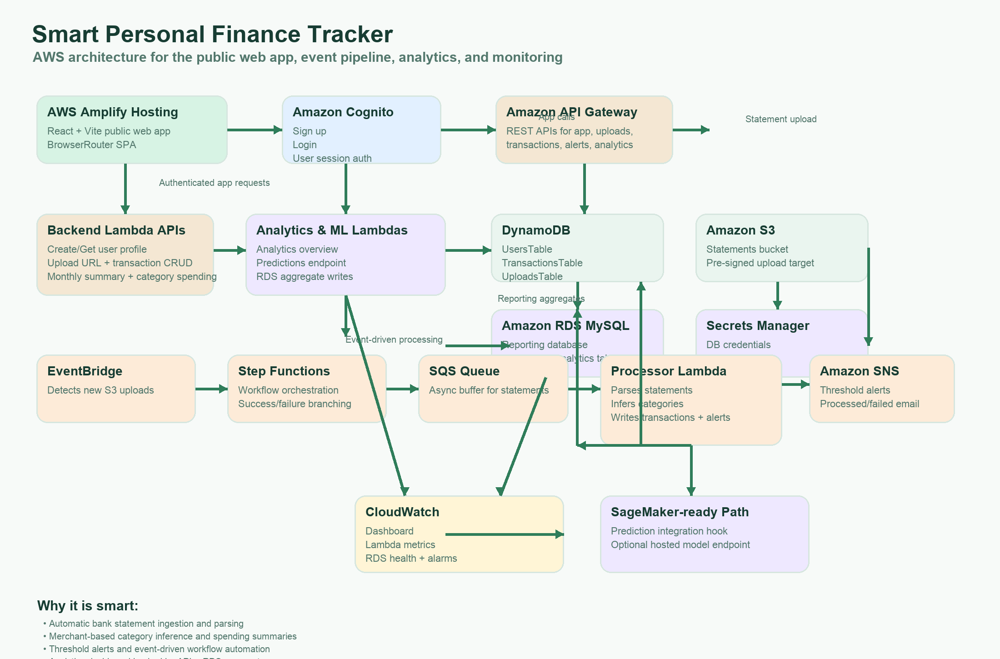

<div align="center">

# LedgerFlow

### Event-Driven Financial Data Processing Platform


</div>

---
LedgerFlow is a cloud-native financial data platform built around serverless computing, asynchronous workflows, and distributed data processing.

The system combines a React-based dashboard with AWS Lambda APIs, event-driven transaction processing, dual-database persistence, and machine learning components for financial analytics.

Rather than treating financial tracking as a simple CRUD application, LedgerFlow explores how cloud services can coordinate ingestion, processing, storage, and reporting across independently deployed components.

## Architecture



LedgerFlow is organized into four major layers:

| Layer | Technologies | Responsibilities |
|---|---|---|
| Frontend | React, TypeScript, AWS Amplify, Cognito | Authentication, financial dashboard, transactions, uploads, and alerts |
| Backend | AWS Lambda, API Gateway, DynamoDB, RDS MySQL | REST APIs, user management, transaction retrieval, and analytics |
| Event Processing | Step Functions, SQS, SNS, EventBridge, S3 | Asynchronous processing, workflow orchestration, and notifications |
| Analytics & ML | Python, SageMaker, CloudWatch | Financial analytics, ML inference components, and monitoring |

### Processing workflow

```text
                  React + TypeScript
                          |
                    Amazon Cognito
                          |
                     API Gateway
                          |
                     AWS Lambda
                          |
               +----------+----------+
               |                     |
           DynamoDB               RDS MySQL
               |
               v
          EventBridge / SQS
               |
               v
           Step Functions
               |
          Processing Lambda
               |
               v
             SNS Alerts

        SageMaker / Analytics
                 |
             CloudWatch
```

*Conceptual architecture showing the major services. Refer to the architecture documentation for implementation-specific data flows.*

## Engineering Highlights

### 01 — Serverless Backend Architecture

- Modular Python Lambda handlers for user profiles, transaction management, spending summaries, and analytics.
- REST API infrastructure defined using AWS CDK.
- DynamoDB and RDS MySQL data models for operational and reporting workloads.
- Infrastructure-as-code definitions for reproducible AWS deployments.

### 02 — Event-Driven Transaction Processing

- A six-stage Step Functions workflow for coordinating statement-processing operations.
- EventBridge, SQS, and Lambda components for asynchronous event handling.
- SNS-based notification components for spending alerts.
- Sample event payloads and workflow definitions for inspecting and testing processing behavior.

### 03 — Financial Analytics & Machine Learning

- Transaction categorization and financial summary APIs.
- Python-based model training and SageMaker inference components.
- Saved model artifacts for category classification, spending regression, and anomaly detection.
- Monitoring and analytics documentation for AWS-based deployments.

### 04 — Full-Stack Financial Dashboard

- React and TypeScript frontend with authenticated application routes.
- Amazon Cognito integration for user authentication.
- Dashboard, transactions, upload, and alert interfaces.
- AWS Amplify configuration for frontend hosting.

## Technology Stack

| Category | Technologies |
|---|---|
| Languages | Python, TypeScript, JavaScript, SQL |
| Frontend | React, Vite, AWS Amplify |
| Backend | AWS Lambda, API Gateway, AWS CDK |
| Databases | DynamoDB, Amazon RDS MySQL |
| Messaging | Amazon SQS, SNS, EventBridge |
| Orchestration | AWS Step Functions |
| Machine Learning | Amazon SageMaker, Python |
| Authentication | Amazon Cognito |
| Monitoring | Amazon CloudWatch |
| Storage | Amazon S3 |

## Project Structure

```text
ledgerflow/
├── frontend/                      # React dashboard and authentication
├── backend/                       # Lambda APIs, data models, CDK infrastructure
├── workflow-events-notifications/ # Event processing and orchestration
├── analytics-ml-monitoring/       # ML models and monitoring assets
├── shared/                        # Shared schemas and sample events
├── docs/                          # Architecture diagrams and screenshots
├── amplify.yml                    # Frontend deployment configuration
└── README.md
```

## Implementation Evidence

The repository includes architecture diagrams, AWS workflow screenshots, infrastructure definitions, sample event payloads, and trained model artifacts.

### AWS Step Functions


### Event Processing


### Notification Workflow


These screenshots document the AWS workflows captured during development; they do not imply that a public production deployment is currently running.

## Getting Started

### Prerequisites

- Python 3
- Node.js and npm
- AWS CLI configured with an AWS account
- AWS CDK
- Appropriate permissions for the AWS resources being deployed

### 1. Clone the repository

```bash
git clone https://github.com/adjascently/ledgerflow.git
cd ledgerflow
```

### 2. Set up backend infrastructure

```bash
cd backend/infra
python3 -m venv .venv
source .venv/bin/activate
pip install -r requirements.txt
npm install -g aws-cdk
cdk bootstrap
cdk deploy
```

AWS resources may incur charges. Review the CDK stacks and required configuration before deployment.

### 3. Configure the frontend

```bash
cd ../../frontend
npm install
cp .env.example .env
```

Update `.env` with the API Gateway endpoint, Cognito identifiers, and AWS region from your deployment.

### 4. Run the frontend

```bash
npm run dev
```

### 5. Explore event processing and analytics

Additional infrastructure and setup instructions are available in:

- `workflow-events-notifications/README.md`
- `analytics-ml-monitoring/README.md`
- `backend/README.md`

Some components require separate AWS configuration or deployment. The repository includes both implemented components and integration assets; cloning it alone does not provision a complete running cloud environment.

## Design Considerations

**Why serverless?**  
Lambda and managed AWS services allow individual components to be deployed and scaled without maintaining application servers.

**Why event-driven processing?**  
Asynchronous messaging and workflow orchestration separate transaction-processing stages from user-facing API requests.

**Why two databases?**  
DynamoDB supports key-based operational access patterns, while relational storage provides a foundation for structured financial reporting.

**Why Step Functions?**  
Explicit workflow definitions make multi-stage processing easier to coordinate, inspect, and troubleshoot than a single monolithic handler.

## Future Improvements

- Expand automated integration and end-to-end tests.
- Benchmark transaction-processing throughput and latency.
- Strengthen failure recovery, retries, and dead-letter handling.
- Extend ML model evaluation and monitoring.
- Add reproducible deployment validation across infrastructure components.

---

**LedgerFlow** — Exploring event-driven architecture, serverless infrastructure, and financial data engineering on AWS.
