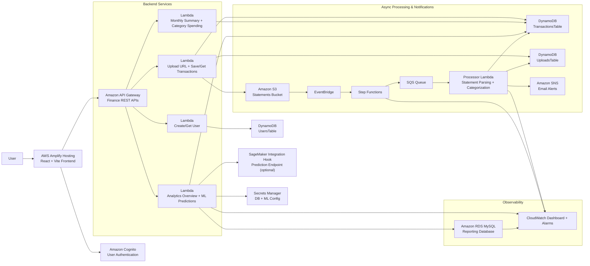

# AWS Architecture Diagram

## Key Flow

1. The user opens the public frontend hosted on AWS Amplify.
2. Cognito handles sign-up and login.
3. API Gateway sends requests to backend Lambdas for profile, upload, transactions, summaries, and analytics.
4. Statements are uploaded to S3 using pre-signed URLs.
5. S3 upload events trigger the workflow pipeline:
   EventBridge -> Step Functions -> SQS -> processor Lambda -> SNS.
6. Parsed transactions are stored in DynamoDB.
7. Analytics Lambdas aggregate data into RDS and return dashboard insights to the frontend.
8. CloudWatch monitors Lambda, workflow, and reporting database health.

## Why This Is a Smart Financial Tracker

This project is more than a CRUD expense app because it adds automated analysis and event-driven behavior on top of stored financial data:

- It parses uploaded bank statements into structured transactions instead of requiring manual entry.
- It automatically categorizes merchants into spending groups such as shopping, transport, groceries, housing, and transfers.
- It computes monthly summaries, category breakdowns, top merchants, largest expenses, daily spend trends, and dashboard metrics.
- It sends automated threshold-based alert emails when spending exceeds the configured limit.
- It stores reporting aggregates in RDS for richer analytics and future BI/reporting extensions.
- It includes an ML prediction integration path through the analytics backend and SageMaker-ready configuration.
- It adds observability through CloudWatch dashboards and alarms so the system can be monitored like a production AWS application.

That combination of ingestion, categorization, analytics, alerting, and prediction-ready architecture is what makes it a **smart** personal finance tracker rather than just a basic tracker.
